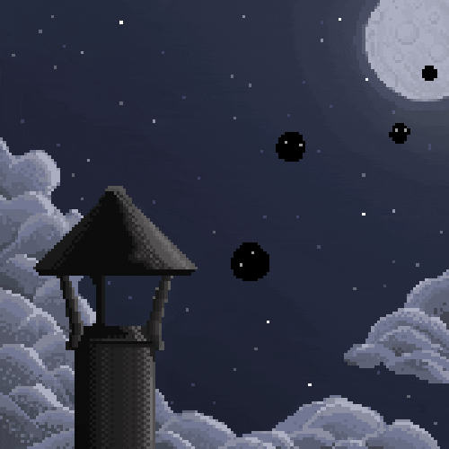

<table>
  <tr>
    <td width="50%" align="center" valign="middle">
      
    </td>
    <td width="50%" valign="middle">
      
<strong>Hey, I'm Khoa.</strong>

      
Software Engineering student.

      
I'm a FOSS enthusiast who enjoys exploring open-source software and building <em>"useful"</em> things of my own.

      
<em>"A developer's ability is measured by the bugs they get"</em>

      <h3>Featured projects</h3>
      
      
    </td>
  </tr>
</table>
